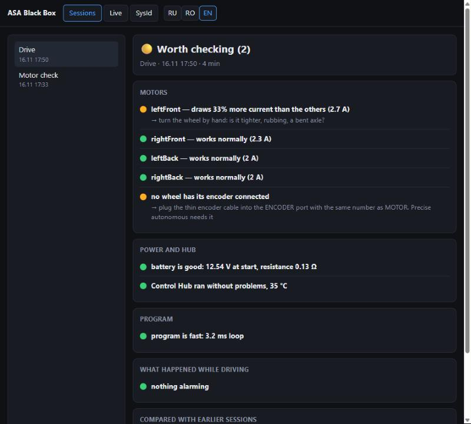

# ASA Black Box for FTC

[](https://github.com/stanchevicid-hash/asa-blackbox/actions/workflows/tests.yml)
[](https://github.com/stanchevicid-hash/asa-blackbox/actions/workflows/android.yml)

**A flight recorder and health monitor for your FTC robot.** It logs every motor, servo and the battery plus
your own signals and events. It detects problems while the robot drives and shows whether the robot is getting
worse from session to session.

Made by **ASA, FTC team 28284**. MIT license, free for every team.

**Follow ASA:** [Instagram](https://www.instagram.com/asa.ftc_md/) · [TikTok](https://www.tiktok.com/@ftc.team.asa) · ⭐ star this repo if it helps · [send feedback](https://github.com/stanchevicid-hash/asa-blackbox/issues/new?template=robot-result.yml): what worked, what did not, what to add. Every message makes the next version better.

**Полная инструкция на русском: [GUIDE.ru.md](GUIDE.ru.md)** (установка, запуск, все предупреждения, как это работает).
**Ghid complet în română: [GUIDE.ro.md](GUIDE.ro.md)** (instalare, rulare, toate butoanele și avertismentele, cum funcționează).

## What you get

- **Whole robot in one line**: `FtcBlackBox.attachAll` records power, position, velocity and current for every
  motor, every servo position, the IMU heading, distance sensors, analog inputs, touch sensors, the hubs and the
  battery, plus the loop time. `FtcBlackBox.attachGamepads(bb, gamepad1, gamepad2)` adds the drivers' sticks.
- **Your own signals and events**: targets, states, `SCORE_ATTEMPT`, `INTAKE_JAM`, all on one timeline.
- **Automatic diagnostics** (standard rules added for you):
  - **stall**: high current, no motion, real command (0.5 s; 1 s for a motor without an encoder)
  - **encoder lost**: an encoder that used to move reads 0 while the motor is driven
    (motors without an encoder never trigger it)
  - **brownout**: battery below 8 V
  - **slow loop**: over 50 ms for a second; **loop pause**: a single loop over 150 ms
  - **motor overheating**: RMS current over ~2 minutes above 5 A
  - **drivetrain wheel dragging**: one wheel turning with the others at the same power but drawing 2x their current
    for 2 s (a bent axle, a rubbing wheel, a tight chain). Wheels are found by name (`frontLeft`, `lf`, ...)
  - **frozen IMU**: heading identical to the last bit for 5 s while the motors are driven (a hung I2C bus)
  - **gamepad disconnected** and **low battery at INIT** (below 12.4 V with the robot idle)
  - write your own: `bb.rule("intake-jam").when(...).forTime(0.25)`
- **Baseline**: each session's motor currents, battery and loop time are compared with the median of the
  previous sessions, e.g. `lift.amps peak 5.2 vs 3.4 (+53%)`. It catches a mechanism wearing out before it fails.
- **In the code or in the robot?** Every problem found is labeled. The recording compares what the driver did, what
  the program commanded and what the robot did: sticks pushed with no drive power, power flipping + / − many times a
  second, an encoder counting against its power are **in the code**; no current, a stall, friction, a weak battery
  are **in the robot**.
- **Driver Hub**: warnings in telemetry. **Results page** at `http://192.168.43.1:8099/`, started by itself:
  live graphs while the robot drives, then each session in plain words with graphs and event markers.
- **FTC Dashboard**: if your team uses it, every signal shows up there as a live graph automatically.
  It is found at runtime, so there is no dependency to add.
- **AdvantageScope**: each session downloads as a `.wpilog` from the web UI and opens in
  [AdvantageScope](https://github.com/Mechanical-Advantage/AdvantageScope) with every signal in a tree and the
  events on the timeline. It is validated with the official WPILib log reader. On a laptop:
  `java -cp <classes> org.asa.tools.core.WpiLog session.csv`.
- **Safe for matches**: file writing runs on a background thread, a failing sensor reads NaN, a full disk
  drops rows, and nothing throws into your loop.
- **Hub resets** (static discharge, loose power): reported the moment every encoder of a hub jumps back to 0, and
  whenever a hub stops answering. This is the usual cause of "the robot froze for half a second".
- **Battery health**: the internal resistance of the battery and its wiring, measured from normal driving and
  tracked per battery (`bb.battery("A")`). The report says which battery is getting worse than it used to be.
- **Loop profiler**: `bb.section("vision")` … `bb.section("drive")` … shows where the loop time goes
  (`loop 24 ms: vision 14 ms (59%), drive 3 ms …`).
- **Crash capture**: `bb.crash(e)` saves the error, its stack trace and the last value of every signal.

## Check that it works (10 minutes)

Go through the steps in order. If each step shows what the right column says, everything works.

| # | Do | You should see |
|---|---|---|
| 1 | **Restart Robot**, then pick **ASA Black Box** and press INIT (not START yet) | 🟢 "Every match is recorded (hooked in at power-on)" and the line "RESULTS: … :8099" |
| 2 | Phone or laptop on the robot Wi-Fi, open the address from step 1 | the page with the ASA logo, a green "robot online" dot at the top |
| 3 | In ASA Black Box: **RB** to "Recording test", START. The robot does not move, ~16 s | three green lines: the loop with recording about the same as without, about the expected number of samples, encoders read on every motor |
| 4 | Lift the robot. ASA Black Box → "Health check", START, **Y** | a green "OK … encoder counts up" for every motor. Red or yellow is a real finding: a wire, a port or a direction |
| 5 | Run **your own** TeleOp as usual: INIT, START, drive a minute, STOP | while driving, the page shows "Live" graphs; after STOP it opens the recording named after your OpMode |
| 6 | INIT ASA Black Box again | "Newest recording: <your TeleOp>, time" |
| 7 | There, **Y** → "Automatic recording is off", run your TeleOp | no new recording. Then switch it back on (**Y**) |

Step 1 in yellow ("hooked in only now"): press Restart Robot once and repeat step 1. A red line about the page means
the port is taken by another program: restart the robot.

Step 3 in yellow ("a little slower"): fine to drive, but watch whether the robot behaves differently; red ("clearly
slower"): switch the automatic recording off (**Y**), everything else works without it, and send us a photo.

**Send us** ([form](https://github.com/stanchevicid-hash/asa-blackbox/issues/new?template=robot-result.yml)) a photo of
step 3 and anything red. That is how we learn it works on robots other than ours.

## No code at all: every match is recorded

Install the library, restart the robot once, and that is it. Whenever **any** OpMode runs (your Java TeleOp, your
Autonomous, even a Blocks program), Black Box records it in the background, with nothing added to your code:
motors (power, position, speed, current), servos, battery, hubs, sensors and both gamepads, with every warning above.
Each recording is named after the OpMode, so "TeleOp Main" is compared with your earlier "TeleOp Main" runs.

How it stays out of the way during a match:

- it never changes your hubs (no caching mode, no motor modes) and reads all encoders of a hub with **one** bulk
  read per sample: 20 samples a second with the Control Hub alone, 10 with an Expansion Hub too; motor current
  (the slow read) every 0.4 s; it runs at a lower priority than your OpMode;
- any error stops the recording, never your robot;
- an OpMode that already uses Black Box in its own code (the 4 lines below) is recorded by that code only, not twice;
- INIT then STOP without START is not kept; the newest 300 recordings are kept on the Control Hub, older ones are
  deleted (center of gravity results and battery history are never deleted).

Switch it off or on in the **ASA Black Box** program: **Y** at INIT. Without your code it cannot see your loop time,
your own values (targets, states) or your events: for those, add the 4 lines below.

## Where to see the results

The page starts by itself in every Black Box program (`attachAll` starts it). The Driver Hub shows the line
`RESULTS: phone/laptop on the robot Wi-Fi, open http://192.168.43.1:8099/`.
Connect a phone or laptop to the robot Wi-Fi and open that address once (the phone has no internet while it is on the
robot Wi-Fi; the Driver Hub's own browser works too). Keep the page open, it follows the robot:

- **a program starts** → the page switches to **Live**: graphs of the last 60 s (battery, motor currents, loop time;
  tick the signals you want) and the warnings as they happen;
- **the program stops** → the page opens its recording: in plain words what is fine and what to check, with what to do.
  Graphs are underneath, for a detailed look;
- **opened later** → it shows the newest recording.

The graphs are exact: each screen pixel draws the lowest and highest sample that falls in it, so a spike that lasts one
loop (a stall, a brownout) stays visible in a 4-minute session. Hover a graph for the recorded value and time.
The page speaks the language chosen on the Driver Hub (English, Russian, Romanian), and can be switched with one click.



*A real 4-minute drive of our robot: one wheel draws 33% more current than the others (it turned out to be tighter),
and no encoder cable was plugged in.*

## The ready-made program on the Driver Hub

**ASA Black Box** appears in the Driver Hub's OpMode list as soon as the library is installed. No code to write.
At INIT: **LB / RB** picks the mode, **X** the language (EN, RU, RO), **Y** switches the automatic recording, then
the mode's own settings. The screen also shows whether every match is recorded, the newest recording and the page
address. Press START.

| Mode | What it does |
|---|---|
| **Health check** | Every hub (answering, temperature, voltage), each battery's health from past sessions, and every motor: **Y** turns every motor in turn by itself (0.3 power, 1.5 s each; B stops), or hold A / B to turn the selected one. It tells for each motor: current, encoder counting, direction. INIT: dpad left/right = which battery is in. |
| **Recording test** | Runs a loop like yours 4 s without and 4 s with the automatic recording, twice, and shows the difference in loop time, how many samples were recorded and whether every encoder was read. No motor turns. The test recording is deleted. |
| **Center of gravity** | Measures where the center of gravity is (height, front/back, left/right) with the hub's IMU: tip the robot onto its rear, front, right and left wheels until it balances, pressing A each time. It reports how hard the robot can brake, accelerate and turn before it tips, and the steepest ramp it can stand on. The results page **draws it**: top view and side view with the point, the distances in cm and the tipping lines, plus a traffic light for each limit; the drawing downloads as SVG. Do it again with the lift up to see how much the lift moves it. INIT: dpad = wheelbase and track (cm, wheel contact to wheel contact). No motor moves. |

## Install (2 minutes)

**Android Studio:** download `asa-blackbox-dropin.zip` from the
[latest release](https://github.com/stanchevicid-hash/asa-blackbox/releases/latest) and unzip it at the root of your
FtcRobotController project. The files land in `TeamCode/src/main/java/org/asa/tools/`. Or copy `src/org` there yourself.

**OnBot Java (easiest):** download `asa-blackbox-onbot.zip` from the same release, unzip it, and upload all 16 files
into your usual `teamcode` folder in OnBot Java (no subfolders). Press Build. If the first build fails with
"bad source file", press Build again: OnBot Java sometimes needs a second build after new files arrive.

**Then, once: Restart Robot** (Driver Hub menu ⋮ → Restart Robot). That switches on the automatic recording
below. Until then it starts the first time you run the "ASA Black Box" program.

**OnBot Java, keeping the packages:** create the folders `org/asa/tools/core`, `org/asa/tools/ftc` and `org/asa/tools/blackbox`, then upload
the `.java` files from the matching folders in `src/`. The library itself uses plain Java 7 syntax; only the examples use lambdas.

No Gradle changes and no other dependencies. It works with FTC SDK 9.x through 12.x.
Using both ASA libraries? Install both. The shared files are identical, so overwriting them is fine.

## Your own values and loop time: 4 lines (optional)

Everything above works with no code. Add these lines to an OpMode to also record your loop time, your own values
and events, and your own rules; that OpMode is then recorded by your code instead of the automatic recording.


```java
BlackBox bb = BlackBox.create("teleop");
FtcBlackBox.attachAll(bb, hardwareMap);                       // before start(); also starts the results page
bb.channel("lift").signal("target", () -> target);            // optional: your own signals
waitForStart();
bb.start();
while (opModeIsActive()) {
    // ... your code ...
    bb.update();                                              // once per loop
    FtcBlackBox.show(telemetry, bb);                          // warnings on the Driver Hub
    telemetry.update();
}
bb.stop();                                                    // summary + baseline report
```

More:

```java
bb.event("INTAKE_JAM", "slot 2");
bb.rule("intake-jam").forTime(0.25).show("intake.amps", "intake.vel")
  .when(r -> r.get("intake.amps") > 4 && Math.abs(r.get("intake.vel")) < 50);
bb.notReachingRule("lift-slow", "lift.target", "lift.inches", 1.0, 1.5);
bb.baseline("lift.cycle_s", 0.05);                            // compare your own health metric between sessions
bb.battery("A");                                              // which battery is in: tracked across sessions
bb.profile("vision", "drive");                                // graph these sections over time
bb.section("vision"); /* ... */ bb.section("drive"); /* ... */ // time each part of the loop
bb.encodersReset();                                           // you reset encoders on purpose (not a hub reset)
try { /* loop */ } catch (RuntimeException e) { bb.crash(e); throw e; } finally { bb.stop(); }
```

See `src/org/asa/tools/examples/ExampleTeleOpBlackBox.java`.

## Loop cost

Bulk caching is switched to AUTO on hubs where it was OFF, so position and velocity cost one bulk read.
Motor current is not part of the bulk read (about 2 ms each), so it is sampled every 100 ms, and so is the battery.
Rate-limited reads are spread out: at most 2 per loop, so 8 motor currents never land in the same loop
(that would be a ~16 ms spike). Each `update()` is one pass over the signals; no file IO happens on your thread.
If the files cannot be written (no space, bad path), the Driver Hub shows `BlackBox NOT SAVING: ...` and the
robot keeps running.

## Files

In `/sdcard/FIRST/asa/`, one set per session:

| File | Content |
|---|---|
| `<date>_<tag>.csv` | every signal, every loop |
| `.events.csv` | your events + warnings with timestamps |
| `.summary.csv` | mean and peak of each signal |
| `.report.txt` | warning counts + changes vs previous sessions |

`sample-logs/` holds real sessions recorded in the ASA simulator. Open them in the web UI.

## How reliable are the warnings?

`test/BlackBoxFuzz.java` simulates full 150 s matches on random robots (2-8 motors, some without an encoder) with
realistic healthy driving: spin-up current spikes, reversals, a lift holding at 0.15-0.45 power with its encoder
still, idle motors, battery sag, and 8-25 ms loop jitter. It injects random faults: stalls, lost encoders,
brownouts and slow loops.

The v1.4 detectors (overheating, wheel dragging, loop pause, low battery at start) run in every match too and must
stay silent, since those matches are healthy for them.

| 9000 matches (3 seeds) | Result |
|---|---|
| Injected faults | **10163 of 10165 reported** by the right rule (the 2 misses: 0.6 s stalls, at the detection limit) |
| False alarms | **0** (including the new detectors) |

A stall is reported after 0.5 s of high current with no motion, in one direction (1 s for a motor without an
encoder, whose speed always reads 0). Stalls close to that limit may not be reported (the current is read every
~100 ms). `test/BlackBoxDetectorsTest.java` checks each new detector against its fault and a healthy look-alike.

`test/SoakTest.java` writes 10 simulated minutes (60000 rows × 40 signals) at 10× real speed: no row is dropped,
memory stays flat, every row is intact, and the whole session exports to WPILOG. Both run in CI on every push.

## Tests

`test/BlackBoxSelfTest.java` drives the rules with timed fake signals. It checks that the stall and encoder-lost rules each
fire exactly once, that a motor without an encoder never reports encoder-lost, that a throwing sensor reads NaN,
that the files are written, that the baseline reports a doubled stall current, that no loop does more than 2 slow
reads, and that a disk error is reported instead of thrown.

```bash
javac --release 8 -d out src/org/asa/tools/core/*.java src/org/asa/tools/blackbox/*.java test/BlackBoxSelfTest.java
java -cp out BlackBoxSelfTest
```

## Status

- Verified: compiles against the official FTC SDK **12.0.0** and **9.2.0** (RobotCore + Hardware from Maven),
  the self-test passes, and it ran in the ASA ftc-sim simulator with every device auto-discovered and the web UI live.
- Verified in CI on every push: only Java APIs present on **Android 7.1 (Control Hub)**, and it converts with **D8**.
- Speed: `update()` with 40 signals and 16 rules ≈ 8.5 µs on a laptop (well under 0.1 ms on a Control Hub).
- Web UI tested from a laptop: path-traversal attempts refused, the quit command accepted from the robot only,
  the port handed over after a code reload, and the WPILOG download valid per the official WPILib reader.
- On a real robot: **one run so far** (v1.4.1, our drivebase, Control Hub, Robot Controller 11.1, OnBot Java).
  The single "ASA Black Box" program and the automatic recording (1.5.0) are not yet run on a real robot: the first
  thing to measure there is that the recording does not slow your loop. If you run it, please
  [send your result](https://github.com/stanchevicid-hash/asa-blackbox/issues/new?template=robot-result.yml):
  that is what tells us the warnings are right on robots other than ours.
- Code runs on the Control Hub (or an RC phone). The Driver Hub shows the telemetry.

Shares its core (`Recorder`, `Ftc`, `AsaWeb`) with [asa-sysid](https://github.com/stanchevicid-hash/asa-sysid). Use both: SysId tells
you how the robot *should* behave, and Black Box shows how it *does*.

---

**Follow ASA:** [Instagram](https://www.instagram.com/asa.ftc_md/) · [TikTok](https://www.tiktok.com/@ftc.team.asa) · ⭐ star this repo if it helps · [send feedback](https://github.com/stanchevicid-hash/asa-blackbox/issues/new?template=robot-result.yml): what worked, what did not, what to add. Every message makes the next version better.
